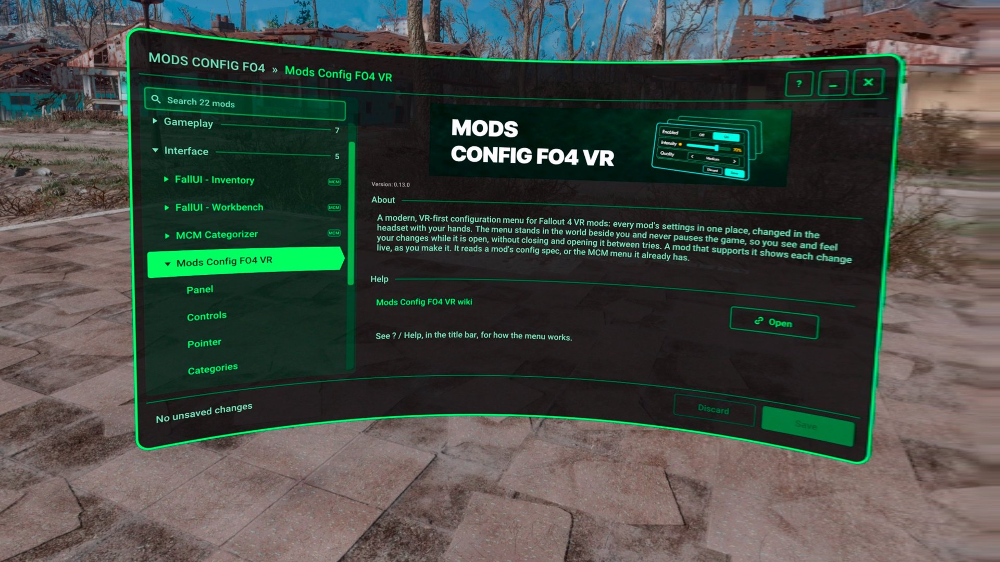
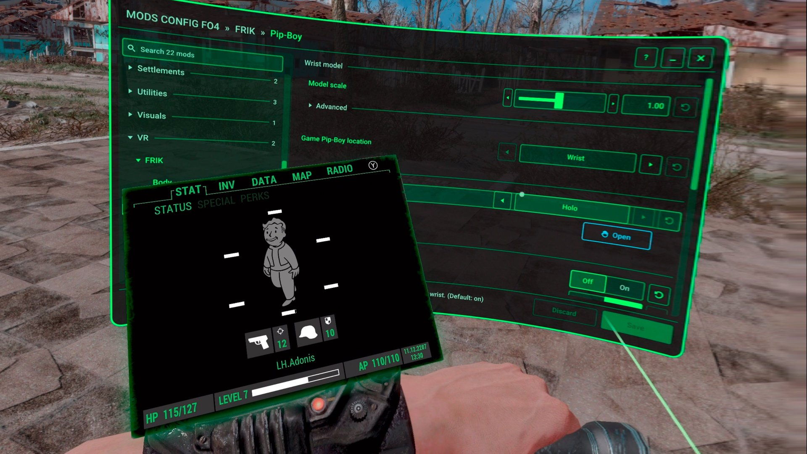
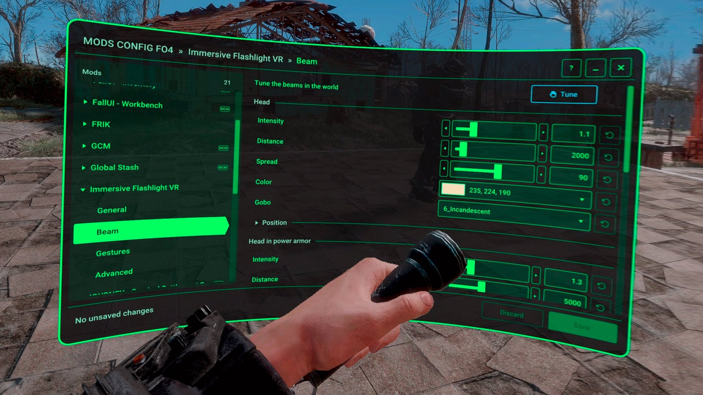
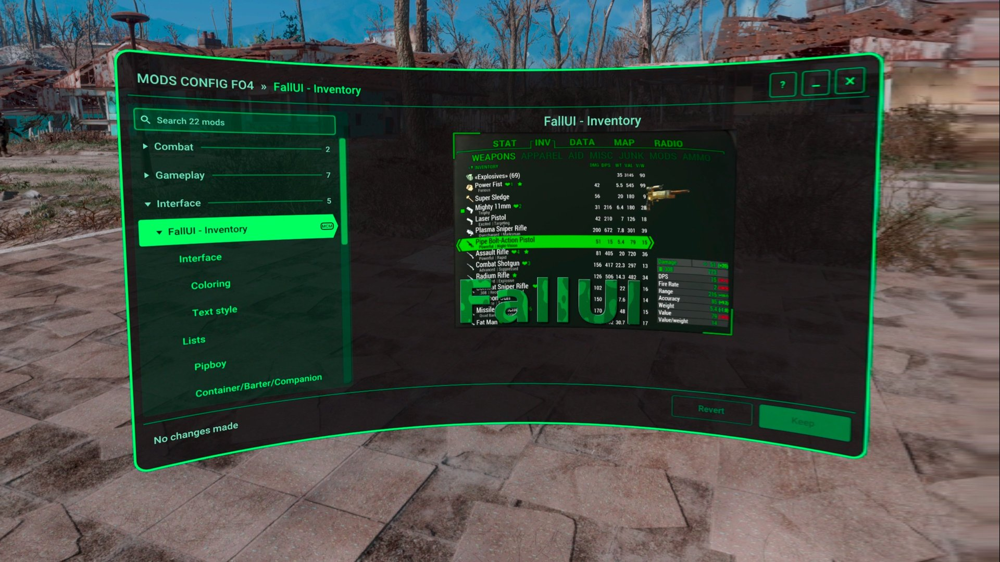
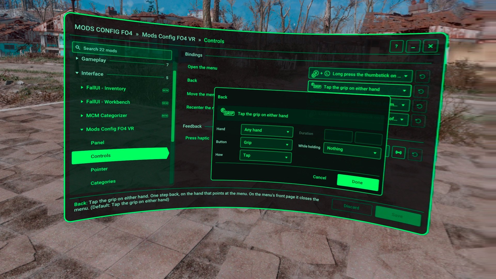

# Mods Config FO4 VR

[](https://github.com/RichardLitt/standard-readme)
[](LICENSE)

> A VR-first settings menu for Fallout 4 VR mods: every mod's settings in one place, changed in the headset.

The menu stands in the world and never pauses the game, so you see and feel your changes while it is open. It shows the MCM menus you already have, and edits the config files of mods that ship a config spec for it, such as FRIK and Immersive Flashlight VR. A mod that supports it shows each change live, as you make it. It is an F4SE plugin (`ModsConfigFO4VR.dll`) built on the [F4VR Common Framework](https://github.com/ArthurHub/F4VR-CommonFramework).



It is in alpha: mod categories, editing lists and hand poses, and translations of mods that have no game plugin are still to come.

## Table of Contents

- [Features](#features)
- [Install](#install)
- [Usage](#usage)
- [For mod authors](#for-mod-authors)
- [Development](#development)
- [Maintainers](#maintainers)
- [Contributing](#contributing)
- [Support](#support)
- [Acknowledgements](#acknowledgements)
- [License](#license)

## Features

- **MCM mods as they are:** every MCM menu you have, with its pages, images and translations. Its buttons and presets run their scripts, and its hotkeys are shown. A change is made as you make it, as in MCM, and you keep it or revert it. Its text inputs are typed on SteamVR's keyboard, which MCM in VR has none of.
- **Mods with a config spec:** the menu edits the mod's own TOML and INI files and its script settings, and a file keeps its comments and its layout.
- **Safe editing:** nothing is written until you Save. Discard drops your changes, each row undoes its own, and Reset sets the default. A value that isn't valid is marked red with the reason, and each setting says when it takes effect.
- **Live preview:** a mod that supports it shows your change in the game as you make it, before you Save.
- **Controls made for VR:** sliders, switches, dropdowns, colors with a picker, controller bindings with an editor, haptic patterns, positions adjusted in the world, and text typed on SteamVR's keyboard.
- **Search:** type a name to find a setting in every mod. The list shows the mods and pages that match, and a page only its settings that match.
- **Quick launch:** open a mod's own config, such as FRIK's, from the menu's front page.
- **Comfort:** a curved panel you move, size and place as you like. It works with or without FRIK, and without MCM.

| | |
| --- | --- |
|  |  |
|  |  |

## Install

### Requirements

- [F4SE VR](https://f4se.silverlock.org/)
- [VR Address Library for F4SEVR Plugins](https://www.nexusmods.com/fallout4/mods/64879)

Optional:

- MCM VR, to show MCM menus.
- [FRIK](https://www.nexusmods.com/fallout4/mods/53464), to press the wrist buttons with your fingertip and open FRIK's config from the menu. FRIK v0.80+ ships its config spec.

Install the [Nexus Mods](https://www.nexusmods.com/games/fallout4/mods/110945) package with your mod manager, or extract it into the game's `Data` folder. There is no ESP, so load order doesn't matter. Keep MCM installed: this menu shows MCM's menus, and doesn't replace MCM.

## Usage

Press in both thumbsticks and hold them to open the menu. Point at it with either hand: the trigger presses and the thumbstick scrolls. Tap the grip to go back, and hold it to move the menu. **? Help** in the title bar shows how the menu works, with the buttons your config has.

The menu's own settings are in its list too: pick **Mods Config FO4 VR**. They are kept in `Documents\My Games\Fallout4VR\Mods_Config\ModsConfigFO4VR\ModsConfigFO4VR.toml`, which the running game reloads as you save it.

- [Documentation](docs/README.md): using the menu, and giving your mod a menu
- [FAQ and Troubleshooting](docs/faq.md)
- [Changelog](docs/changelog.md)

## For mod authors

- A **config spec** gives your mod a menu with no code: one `spec.json` installed with your mod, which reads and writes your INI or TOML files and your scripts' globals and properties.
- A mod built on the F4VR Common Framework gets live preview with no code of its own.
- A DLL can register with the **native API** for live preview, buttons that run its functions, and its own UI opened from the menu.
- The optional **Showcase** download has a config spec and an MCM menu that use every feature: start from it.

Start at [For Mod Authors](docs/for-mod-authors/README.md).

## Development

```sh
git clone https://github.com/ArthurHub/F4VR-Mods-Config.git
cd F4VR-Mods-Config
git submodule update --init --recursive
cmake --preset default
cmake --build --preset release
```

It needs Visual Studio 2022 or 2026 (x64, C++ desktop workload), CMake 4.2+ and `VCPKG_ROOT`; the framework's [Creating a new mod](https://github.com/ArthurHub/F4VR-CommonFramework/blob/main/docs/creating-a-new-mod.md) has the toolchain.

- `cmake --build --preset package` builds the versioned `.7z` in `build/package/`, and the optional Showcase archive from `data/showcase/`.
- `cmake --build --preset tracy` is a Release build whose timed sections are also [Tracy](https://github.com/wolfpld/tracy) zones.
- The build also makes `ModsConfigFO4VR_tests`, the unit tests of the code that does not need the game: `ctest --test-dir build -C Release --output-on-failure`.
- `CMakeUserPresets.json.template` has a preset that copies the DLL to your game on each build.

The design is in [docs/design/](docs/design/README.md).

## Maintainers

- [@ArthurHub](https://github.com/ArthurHub)

## Contributing

PRs accepted. For larger changes, please open an issue first to discuss what you would like to change.

Code style is enforced by clang-format and pre-commit: run `pre-commit install` once after cloning. A Release build, the unit tests and pre-commit run on GitHub for every push and pull request to `main`.

## Support

If you like my work, consider helping out.

[](https://patreon.com/theartofdev)

## Acknowledgements

This mod is built on the work of the Fallout VR modding community and public code.

- Ryan, rsm, McKenzie, alandtse, devartificial, and the other [CommonLibVR](https://github.com/alandtse/CommonLibVR/tree/vr) contributors.
- Neanka, reg2k and the [Mod Configuration Menu](https://www.nexusmods.com/fallout4/mods/21497) team, whose menus this one shows and whose design it follows.
- Omar Cornut and the [Dear ImGui](https://github.com/ocornut/imgui) contributors: it draws the menu.
- RollingRock, alandtse, shizof, and CylonSurfer for FRIK, whose config gesture the menu opens with.
- alandtse and RollingRock for [devbench](https://github.com/ArthurHub/devbench), which the menu is tested with in the running game.

## License

[GPL-3.0-or-later](LICENSE) © 2026 Arthur T
