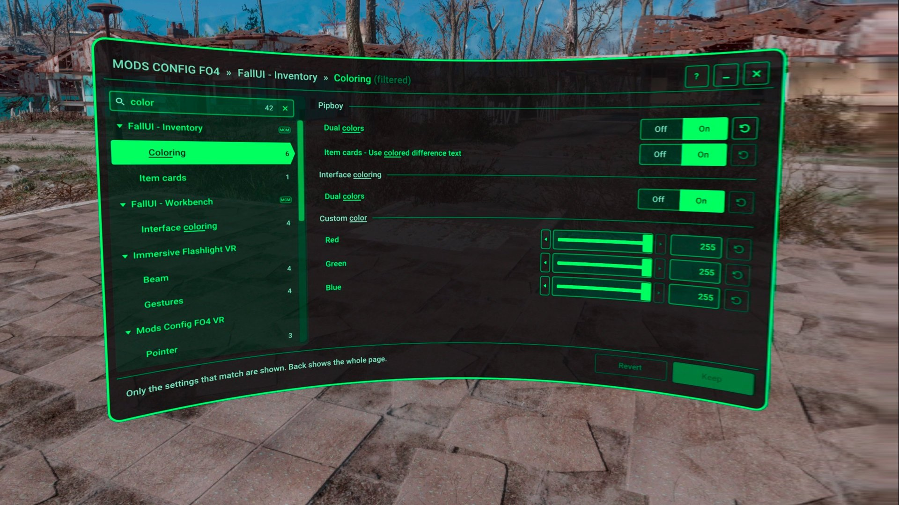
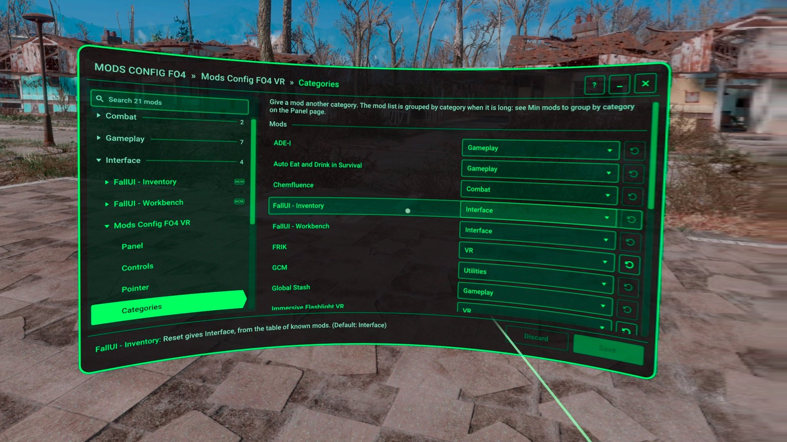
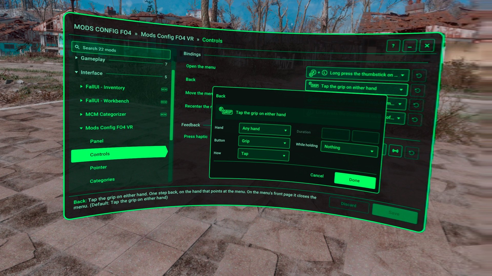

# Mods Config FO4 VR documentation

A VR-first settings menu for Fallout 4 VR mods: every mod's settings in one place, changed in the headset. It shows the MCM menus you already have, and edits the config files of mods that ship a config spec for it.

### [Install](../README.md) · [FAQ](faq.md) · [Changelog](changelog.md) · [For Mod Authors](for-mod-authors/README.md)

### Contents

- [Quick Start](#quick-start)
- [Editing a Mod's Settings](#editing-a-mods-settings)
- [Search](#search)
- [Mod Categories](#mod-categories)
- [The Menu's Own Settings](#the-menus-own-settings)

## Quick Start

- **Open / Close:** Hold both thumbsticks down. It also restores a minimized menu.
- **Point and select:** One hand controls the menu at a time, the one with the mark at the end of its ray. Its trigger selects and its thumbstick scrolls, and neither reaches the game while you point at the menu. [Switching hands](faq.md#the-menu-itself).
- **Back:** Tap the pointing hand's grip to close a popup, cancel an edit, or go back a page. From Help it returns to your page; from the front page it closes the menu.
- **Move:** Point at the menu, hold the grip, move your hand, and release.
- **Recenter:** Hold the offhand thumbstick down to bring the menu in front of you. It also comes back by itself when you walk too far away.
- **Navigate:** Select a page in the title bar's breadcrumbs to jump back, or **MODS CONFIG FO4** for the front page.
- **Minimize:** **–** in the title bar hides the menu and keeps your page and edits. **Restore** on your offhand wrist brings it back with fresh values; **Exit** closes it, asking first if you have unsaved changes.
- **Help:** **?** in the title bar opens the Help page, with your controls. The line at the bottom explains what you point at.

## Editing a Mod's Settings

Pick a mod in the list on the left. Its front page opens, and its pages are under it in the list.

- **Save and Discard:** a change of a mod with a config spec waits for **Save**, which writes it to the mod's file. **Discard** drops your changes. Leaving a mod or closing the menu with changes asks first.
- **Undo one change:** a changed value is amber, and the arrow after it takes back that change alone.
- **Reset:** sets the mod's default. The help line names it.
- **A value that isn't valid** is red, with the reason in the help line. Save waits until it's fixed.
- **When a change takes effect:** each setting says it. A live one shows in the game as you change it, before you Save, and Discard puts the old value back in the game too. Others take effect on Save, or after a restart, which the front page then reminds you of.
- **MCM mods** have the `MCM` tag in the list. As in MCM's own menu, a change is made in the game as you make it: **Keep** accepts it and **Revert** sets it back.

The menu doesn't pause the game, so a live change shows in the world while the menu stays open.

## Search

The list's header is a search field: type a name and the list shows the mods and pages with a setting that matches, with how many. A page shows only its settings that match, marked `(filtered)`, and **Back** shows the whole page.

## Mod Categories

With 20 mods or more, the list is grouped by category: Gameplay, Interface, Settlements and so on, with **No category** last. A press on a category opens or closes it. A mod is in the category its author gave it, or the one the menu knows for it.

To move a mod, pick **Mods Config FO4 VR**, then the **Categories** page: each mod has a dropdown of the categories. **Type a new name**, last in the list, makes a category of your own. Save keeps your choices, and **Reset** puts a mod back in its own category. Change from how many mods the list is grouped with **Min mods to group by category** on the **Panel** page: 0 always groups it.

## The Menu's Own Settings

The menu is in its own list: pick **Mods Config FO4 VR**. Its changes apply as you make them, and Save keeps them.

| Page | What's there |
| --- | --- |
| **Panel** | How big the menu is and where it stands: its scale, its distance and how high it is, the background's opacity, its width and height, the mod list's width, the scroll speed, its tilt and curve, how far you walk before it comes back in front of you, how smoothly it follows your hand as you move it, and from how many mods the list is grouped by category. |
| **Controls** | The bindings that open the menu, go back, move it and bring it in front of you, each changed with its editor, and the haptic a press gives. |
| **Pointer** | The ray's color, width, length and fade, the mark where it meets the menu, and where the ray starts on your hand. |
| **Categories** | The category of each mod, with a dropdown per mod. See [Mod Categories](#mod-categories). |
| **Developer** | For a config spec's author: **Developer tools**, which lists each config spec's problems on the menu's front page, and the log's level. |

They are kept in a file the running game reloads as you save it, so you can edit it on the desktop too:

- Config: `%USERPROFILE%\Documents\My Games\Fallout4VR\Mods_Config\ModsConfigFO4VR\ModsConfigFO4VR.toml`
- Your categories: `Categories.toml` beside it, one line per mod you moved.
- Log: `%USERPROFILE%\Documents\My Games\Fallout4VR\F4SE\ModsConfigFO4VR.log`
