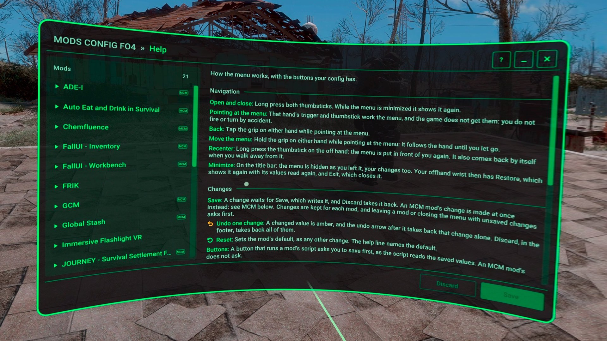

# Mods Config FO4 VR documentation

A VR-first settings menu for Fallout 4 VR mods: every mod's settings in one place, changed in the headset. The menu shows the MCM menus you already have, and edits the config files of mods that ship a config spec for it.

Install and requirements: [main README](../README.md). Problems: [FAQ](faq.md).

## Contents

- [Quick Start](#quick-start)
- [Editing a Mod's Settings](#editing-a-mods-settings)
- [For Players](#for-players)
- [For Mod Authors](#for-mod-authors)
- [Design](#design)

## Quick Start

- **Open and close:** press in both thumbsticks and hold them. While the menu is minimized, this shows it again.
- **Point:** the hand that points at the menu works it. The trigger presses and the thumbstick scrolls, and the game doesn't get them while you point.
- **Back:** tap the grip of the hand that points. On the menu's front page it closes the menu.
- **Move the menu:** point at it and hold the grip. It follows your hand until you let go.
- **Bring it in front of you:** press in the offhand thumbstick and hold it. Walk away from the menu and it comes back by itself.
- **Minimize:** the `–` in the title bar hides the menu, so you can see your change in the world. **Restore** and **Exit** are then on your offhand wrist.
- **Help:** **? Help** in the title bar shows how the menu works, with the buttons your config has. The line at the bottom of the menu shows the help of whatever you point at.

## Editing a Mod's Settings

Pick a mod in the list on the left. Its front page opens, and its pages are under it in the list.

- **Save and Discard:** a change of a mod with a config spec waits for **Save**, which writes it to the mod's file. **Discard** drops your changes. Leaving a mod or closing the menu with changes asks first.
- **Undo one change:** a changed value is amber, and the arrow after it takes back that change alone.
- **Reset:** sets the mod's default. The help line names it.
- **A value that isn't valid** is red, with the reason in the help line. Save waits until it's fixed.
- **When a change takes effect:** each setting says it. A live one shows in the game as you change it, before you Save, and Discard puts the old value back in the game too. Others take effect on Save, or after a restart, which the front page then reminds you of.
- **MCM mods** have the `MCM` tag in the list. As in MCM's own menu, a change is made in the game as you make it: **Keep** accepts it and **Revert** sets it back.

The game keeps running while the menu is open, so you can try a change, look at it, and change it again without closing the menu.

## For Players

- The in-game **Help** page, from **? Help** in the title bar.
- The [FAQ and Troubleshooting](faq.md).
- The menu's own settings are in its list: pick **Mods Config FO4 VR**. They are kept in a file the running game reloads as you save it:
  - Config: `%USERPROFILE%\Documents\My Games\Fallout4VR\Mods_Config\ModsConfigFO4VR\ModsConfigFO4VR.toml`
  - Log: `%USERPROFILE%\Documents\My Games\Fallout4VR\F4SE\ModsConfigFO4VR.log`

## For Mod Authors

A config spec gives your mod a menu with no code: one `spec.json`, installed with your mod under `Data\ModsConfigFO4\Config\<your mod>\`, which reads and writes your INI or TOML files and your scripts' globals and properties. A DLL can also register with the native API, for live preview, buttons that run its functions, and its own UI opened from the menu.

The guides for authors are being written. Until they are:

- **The Showcase**, an optional download on the Nexus page, has a config spec and an MCM menu that use every feature. Its config spec is the sample: keep its front page and its General page, and delete the detailed pages.
- **Developer tools**, on the Developer page of the menu's own settings, lists each config spec's errors and warnings on the menu's front page, and reads a live copy of your `spec.json` that reloads as you save it.
- **The config spec format** is specified in [Declarative schema](design/schema.md), and the native API in [Architecture](design/architecture.md#native-api). The client header is [src/api/ModsConfigFO4Api.h](../src/api/ModsConfigFO4Api.h).

## Design

How the menu is designed and built, and the plan of its work: [docs/design](design/README.md).
