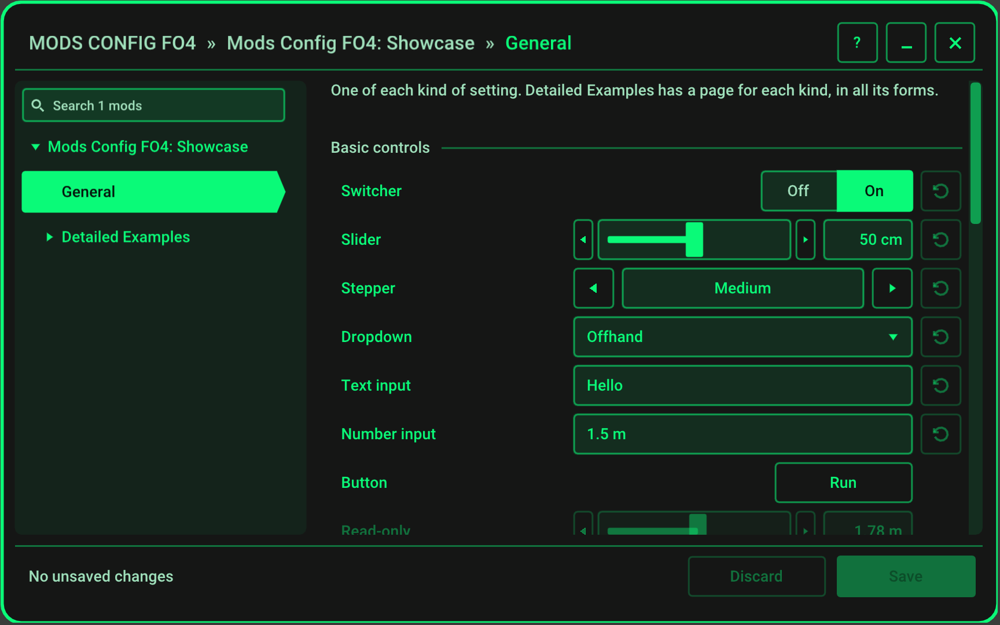
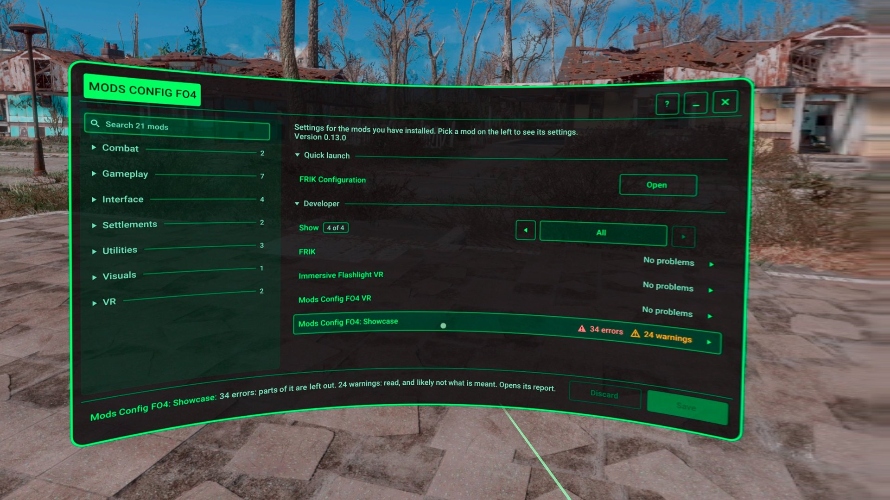
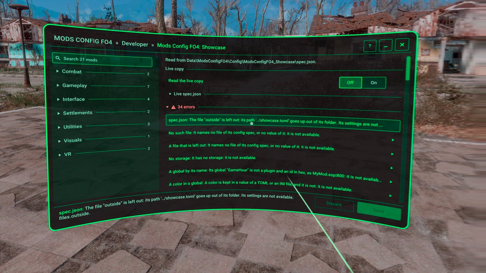

# For Mod Authors

How to give your mod a page in Mods Config FO4 VR: why a config spec, your first one, how it ships with your mod, and how you test it in the game.

- [Why a Config Spec](#why-a-config-spec)
- [Your First Config Spec](#your-first-config-spec)
- [Testing It in the Game](#testing-it-in-the-game)
- [Shipping It](#shipping-it)
- More
  - [Showcase walkthrough](showcase.md)
  - [MCM compatibility](mcm.md)
  - [Config Spec vs MCM](config-spec-vs-mcm.md)
  - [Native API](native-api.md)
  - [AI agent prompt](ai-agent.md)
  - [FAQ](../faq.md#for-mod-authors)

## Why a Config Spec

Your MCM menu already works in Mods Config FO4 VR, as it is. A config spec gives your players, and you, more:

- **Your own files:** INI and TOML files, in `Data` or `My Games`, and your scripts' globals and properties, edited in place.
- **A richer page, with no code:** pages and sections that nest, conditions, warnings, presets, and images as textures.
- **Save and Discard,** with Reset to a default, and when each change takes effect.
- **Live preview** before Save, for globals, properties and any DLL.
- **The Common Framework's controls:** bindings, haptics, colors, and positions tuned in the world.
- **Tools for you:** errors and warnings with where each is, and a live copy that reloads as you save it. See [Testing It in the Game](#testing-it-in-the-game).

The full list, and moving from MCM: [Config spec vs MCM](config-spec-vs-mcm.md).

### From No Code to a DLL

- **No code:** a config spec, one `spec.json`, is all a mod with its settings in files, globals or properties needs.
- **The [native API](native-api.md),** for a mod with a DLL: live preview of each change before Save, buttons that run your functions, states and options only your code knows, your own UI opened from the menu, and what the player is on, to show in the world what it sets.
- **Easier on the [F4VR Common Framework](https://github.com/ArthurHub/F4VR-CommonFramework):** the framework connects your DLL by itself and handles the config's lifecycle. It applies each live change by reloading your config, with no code, and you add only what is your own, through the same API.

### Keep Your MCM Menu Too

You don't lose the players who don't have Mods Config FO4 VR. Ship your config spec beside your MCM config, with the same `modName`: this menu shows the config spec, and MCM keeps showing your MCM menu to everyone else.

Moving is quick, since a config spec uses MCM's names and most of an MCM config carries over: [Moving From MCM](config-spec-vs-mcm.md#moving-from-mcm). A global or a property is the same value in both menus; a ModSetting isn't: [Keeping Both](mcm.md#keeping-both).

## Your First Config Spec

Start from the Showcase: an optional download on the Nexus page, whose config spec uses every feature. Its front page and its **General** page are a complete small config spec, and its **Detailed Examples** page has everything else.

An AI agent can write it for you, from your mod's files: [the prompt](ai-agent.md).



1. Copy the Showcase's `Data\ModsConfigFO4\Config\ModsConfigFO4_Showcase\spec.json` to `Data\ModsConfigFO4\Config\<your mod>\spec.json`. The folder's name is yours to choose.
2. Delete the **Detailed Examples** page: the second entry of `pages`.
3. Set who it is:
   - `modName`: your mod's identity. For a CommonFramework mod it is the mod's own name, which the framework connects to the menu under, as `FRIK` or `ImmersiveFlashlightVR`.
   - `displayName`, the name in the menu's list, and `help`, what your mod is, shown while the player points at its name.
   - `pluginRequirements`, your game plugins, and `f4sePluginRequirements`, your F4SE plugin. While one isn't loaded, your mod is greyed out, with the reason.
4. Replace `files` with your file, and set `defaultFile` to its name. For a CommonFramework mod:

   ```json
   "files": {
     "config": { "format": "toml", "root": "myGames", "path": "Mods_Config/MyMod/MyMod.toml", "pathFromClientState": "configFile" }
   },
   "defaultFile": "config",
   ```

   `root` is `myGames`, the game's `Documents\My Games\Fallout4VR`, or `data`, its `Data` folder. `pathFromClientState` makes the menu edit the file your mod loaded, wherever that is.
5. Set `applies`, when a change takes effect in your mod: `live` for a CommonFramework mod, which previews it, `save` for a mod that reads its file again as it changes, `restart` for one that reads it only as the game starts.
6. Make the front page yours: the banner's `texture`, a path under `Data\Textures`, the **About** text, and the URL of the **Help** button.
7. Make the General page yours: each row's `text`, `help` and `default`, and its `storage`, the section and key of your file:

   ```json
   {
     "type": "switcher",
     "valueType": "bool",
     "text": "Enabled",
     "help": "Turns the mod on and off.",
     "default": true,
     "storage": { "path": ["Main", "bEnabled"] }
   }
   ```

   Delete the rows you don't need, and copy more from the Detailed Examples, where each control is shown in all its forms: the [Showcase walkthrough](showcase.md) goes through them.

Every field is in the [config spec schema](../design/schema.md).

## Testing It in the Game

Turn on **Developer tools**: in the menu, pick **Mods Config FO4 VR**, then the **Developer** page.

- The menu's front page then has a **Developer** section, with each config spec's errors and warnings. Press your mod's row for its report: each problem, and where it is in `spec.json`. A press on a problem goes to its row.
- **Read the live copy**, in the report, copies your `spec.json` to `Documents\My Games\Fallout4VR\Mods_Config\ModsConfigFO4VR\Dev\<your mod>\spec.json` and reads that copy instead. It reads it again each time you save it, so you edit it on the desktop while the game runs, and see the change in the headset. **Edit on desktop** opens it in your editor. When it's right, copy it back into your mod.
- The log, `Documents\My Games\Fallout4VR\F4SE\ModsConfigFO4VR.log`, has every problem too.

| | |
| --- | --- |
| [](../assets/developer-front-page.jpg) | [](../assets/developer-report.jpg) |

The Showcase's **Mistakes** page has what a config spec can get wrong, each with the error the menu reports.

## Shipping It

The config spec ships in your mod's archive, beside the rest of your files:

```text
Data\
  F4SE\Plugins\MyMod.dll
  ModsConfigFO4\Config\MyMod\spec.json
  Textures\MyMod\banner.dds
```

- Mods Config FO4 VR is not a requirement of your mod: without it, `spec.json` is a file nobody reads.
- `minSchemaVersion` is `1`. From version 1.0 of Mods Config FO4 VR the schema only grows, so a config spec keeps working on every later version.
- Your settings file doesn't have to exist: the menu creates it on the first Save that changes one of its settings.
- Give your mod a `category`, as `"category": "Gameplay"`, so a long list shows it under that name. Use one of the twelve shipped names where one fits: [Category](../design/schema.md#category). An MCM config can have the same root field.
