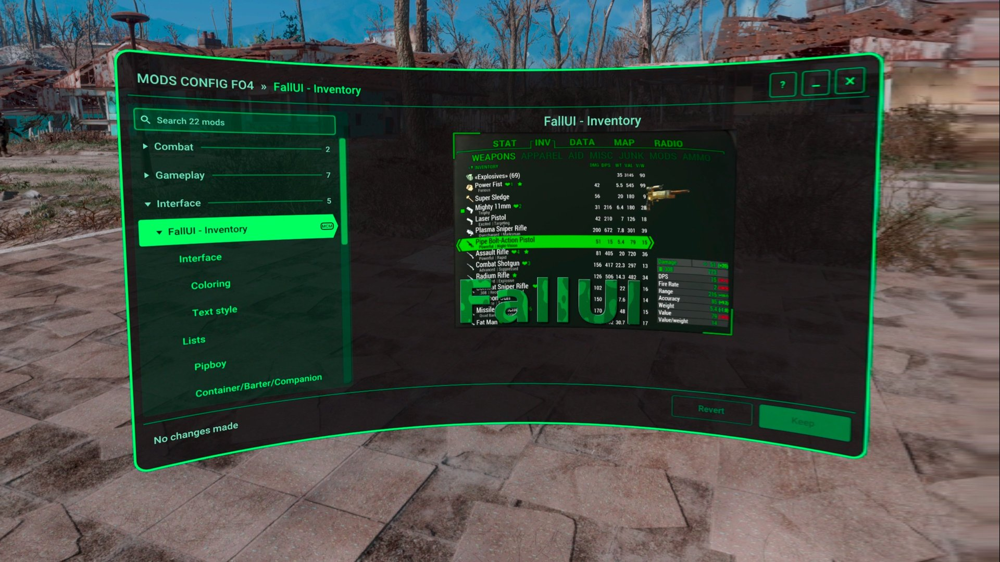

# MCM Compatibility

What your MCM menu gets in Mods Config FO4 VR as it is, and shipping a config spec beside it.

Where to start: [For Mod Authors](README.md). What a config spec has beyond MCM, and moving to one: [Config spec vs MCM](config-spec-vs-mcm.md). How the menu handles each MCM feature, in full: [MCM support](../design/mcm.md).

## Contents

- [Your MCM Menu, as It Is](#your-mcm-menu-as-it-is)
- [Keeping Both](#keeping-both)

## Your MCM Menu, as It Is

You don't have to do anything. While MCM VR is installed, the menu reads your `Data\MCM\Config\<mod>\config.json` as MCM's menu reads it, and shows it in VR, with the `MCM` tag on your mod's row.

**What works as in MCM's menu:** your pages, every row MCM's menu draws, `help` in the help line, `html` text, `groupControl` and `groupCondition`, `sharedLists`, `listFromForm` and `listFromProperty`, the `$` tokens of your translation files, FallUI's language files, and your images, read from your `lib.swf`. A value is written as MCM writes it: a global and a property into the game, and a ModSetting through `MCM.SetModSetting*`. A row's `CallFunction` and `CallGlobalFunction` run, and `OnMCMSettingChange` is sent, as each change is made.

**What the player sees differently:**

- **Keep and Revert.** A change is made in the game as the player makes it, as in MCM's menu, and stays a change of the session until **Keep** accepts it. **Revert** sets the changes back, each as a change is made: its value is written, its action runs again and its event is sent, so a preset that is set back sets its rows back.
- **Text inputs are typed in the headset,** on SteamVR's keyboard, or a real one. MCM's menu in VR has no keyboard for them.
- **Reset** sets a ModSetting to its default from your `settings.ini`, which MCM's menu can't do.
- **The game keeps running** while the menu is open, so your script acts on a change while the player looks.
- **Hotkeys are shown, not edited.** MCM keeps binding and running them, and the player changes them in MCM's own menu.
- **The list is by name.** Mods are in the order of their display names, not of MCM's `sOrder`, and MCM's own `Hotkey manager` and `MCM Settings` aren't listed.
- **A mod that can't be shown** is greyed out with the reason, as one whose plugin isn't loaded, where MCM's menu shows a page that says why. So is a page whose own `pluginRequirements` aren't loaded, with its `messageIfMissingReqs` after the reason. `hideIfMissingReqs` leaves it out, as in MCM.
- **The menu's events:** `OnMCMMenuOpen|<mod>` and `OnMCMMenuClose|<mod>` are sent as your mod is picked and left, where MCM's menu sends none.
- **A DLL that reads MCM's settings file as the pause menu closes** gets the changes when the player presses Keep: the menu then tells the game the pause menu opened and closed.

**What isn't run:** a `positioner`, a `keyinput` and a `customClipLoader` are disabled rows that say the menu has no such control. `CallExternalFunction` calls Flash, which the menu has none of, and `RunConsoleCommand` and `SendEvent` are hotkey actions, which MCM's menu doesn't run in a row either. The code in your `lib.swf` isn't run. An image drawn as vectors, a JPEG, or an animated one is a row that says an image is there.

**What isn't supported:** `ownerModName`. Your config is a mod of its own in the list, and its pages aren't put under another mod.

The **MCM Showcase**, in the Showcase download, is an MCM menu with every kind of row in every look: install it to see how yours will look.

## Keeping Both

Ship your MCM config and a config spec with the same `modName`: this menu shows the config spec, and MCM's own menu the MCM config. A global or a property is the same value in both menus. A ModSetting and a key of your own file are two values, which your mod has to reconcile.
