# The Showcase Walkthrough

Everything a config spec does, page by page of the Showcase: what each page shows, the Showcase's JSON for it, and a picture of the page it draws. Install the Showcase, the optional download on the Nexus page, to try each page in the headset, and open its `spec.json` beside this.

Where to start: [For Mod Authors](README.md). Every field in full: the [config spec schema](../design/schema.md).

The pictures are drawn by the menu's own code outside the game, so they show the flat panel. In the headset it is curved and stands in the world.

## Contents

- **[The front page and General](#the-front-page-and-general)**
- **Controls:** [Switchers](#switchers), [Sliders](#sliders), [Choices](#choices), [Text inputs](#text-inputs), [Buttons](#buttons)
- **CommonFramework values:** [Bindings](#bindings), [Haptics](#haptics), [Colors](#colors), [Transforms](#transforms), [Activation spheres](#activation-spheres)
- **The look of a page:** [Text](#text), [Images](#images), [Numbers](#numbers), [Sections](#sections), [Pages](#pages)
- **How settings behave:** [Read-only](#read-only), [Files](#files), [In the game](#in-the-game), [When a change takes effect](#when-a-change-takes-effect), [Conditions](#conditions), [Warnings](#warnings), [Translations](#translations)
- **[Mistakes](#mistakes)**

## The Front Page and General

A mod's front page is its root `content`, shown when the mod is picked: here a banner, an About section and a Help button. **General** has one of each kind of setting and the patterns a page uses most. Together they are the config spec you start from: see [Your First Config Spec](README.md#your-first-config-spec).

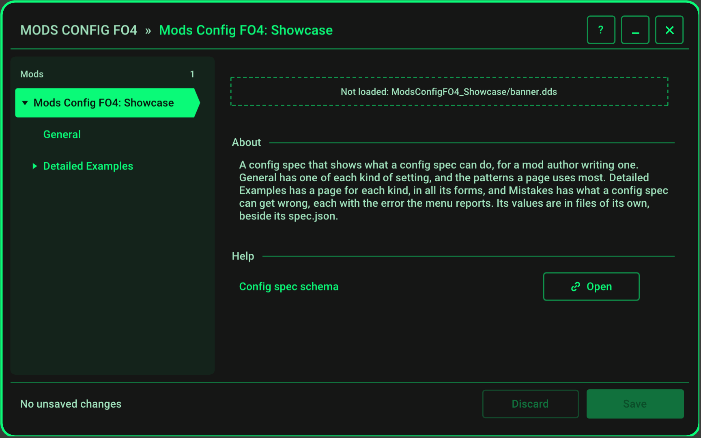

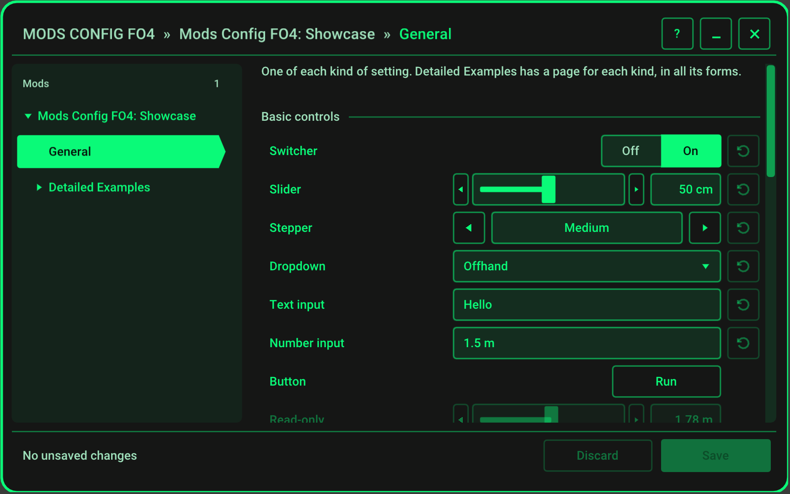

## Controls

Each setting has a `type`, the `text` and `help` the player reads, a `default`, which Reset sets, and a `storage`, where its value is kept. `valueType` is what it stores: `bool`, `int`, `float` or `string`. See [Settings](../design/schema.md#settings).

### Switchers

On or off, a `bool`, written to a TOML file as `true` or `false` and to an INI file as `1` or `0`.

```json
{
  "type": "switcher",
  "valueType": "bool",
  "text": "No help",
  "default": false,
  "storage": { "path": ["Switchers", "bNoHelp"] }
}
```

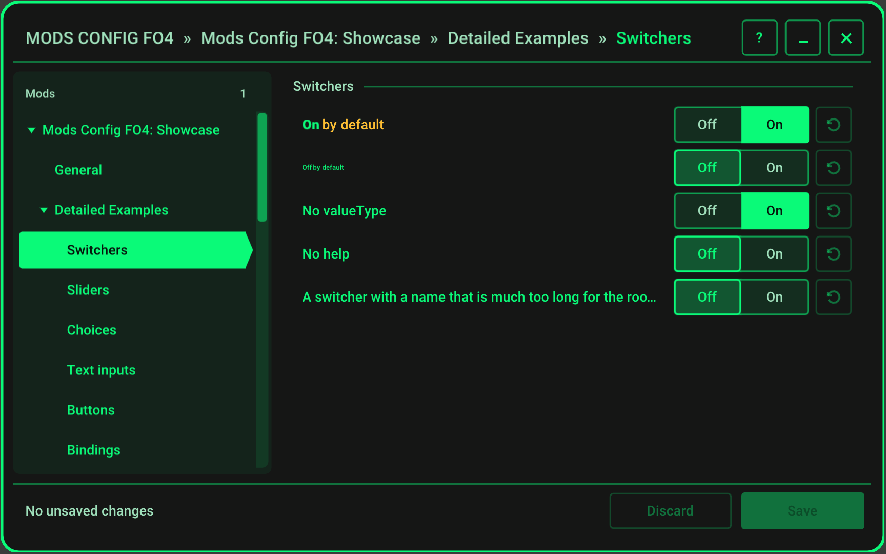

### Sliders

A number in a range. `valueOptions` has its `min`, `max` and `step`, and the arrows at its ends step it.

```json
{
  "type": "slider",
  "valueType": "float",
  "text": "From -100 to 100 by 5",
  "help": "A range below and above zero.",
  "default": -20.0,
  "valueOptions": { "min": -100, "max": 100, "step": 5 },
  "storage": { "path": ["Sliders", "fNegative"] }
}
```

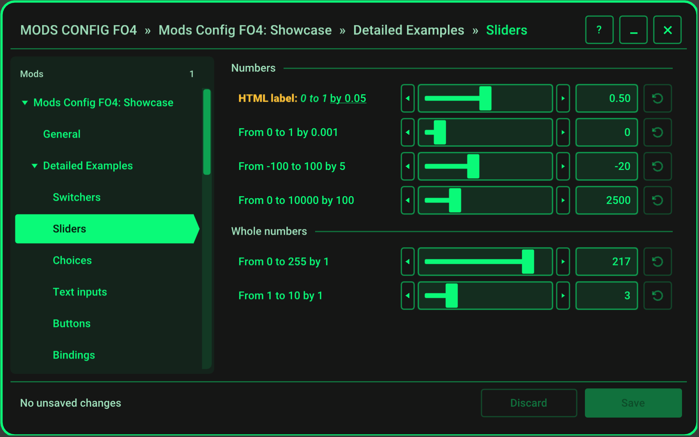

### Choices

A `stepper` steps through its options, and a `dropdown` opens a list. Each option has the `value` stored and the `text` shown:

```json
{
  "type": "stepper",
  "valueType": "string",
  "text": "Values",
  "help": "Options with the text each stores.",
  "default": "normal",
  "valueOptions": {
    "options": [
      { "value": "slow", "text": "Slow" },
      { "value": "normal", "text": "Normal" },
      { "value": "fast", "text": "Fast" }
    ]
  },
  "storage": { "path": ["Choices", "sStepper"] }
}
```

The options can also come from elsewhere:

- A **shared list**, written once in the root's `sharedLists` and named by several choices: `"valueOptions": { "sharedOptions": "Hands" }`. See [Shared lists](../design/schema.md#shared-lists).
- **The game:** `"listFromForm": "Fallout4.esm|1D98E2"`, the names of a FormList's forms, here the settlements. See [Options from the game](../design/schema.md#options-from-the-game).
- **A folder:** `"listFromFolder": { "path": "Textures/ModsConfigFO4_Showcase", "mask": "*.dds" }`, the files a player can add to, as MCM's `dropdownFiles`. See [Options from a folder](../design/schema.md#options-from-a-folder).

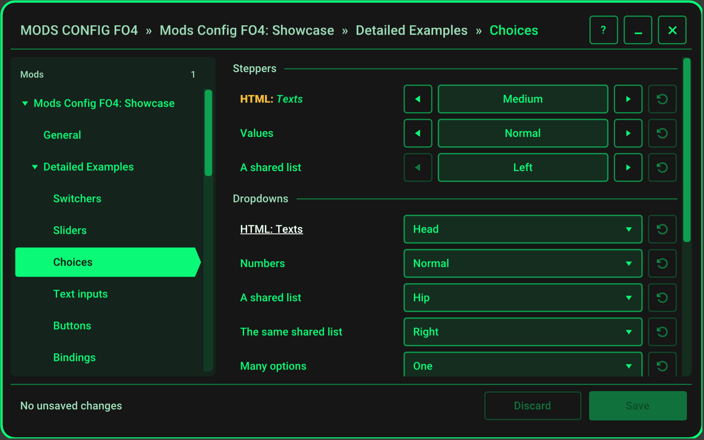

A press on a dropdown opens its list, and a list of a folder's files says the folder and how many it has:

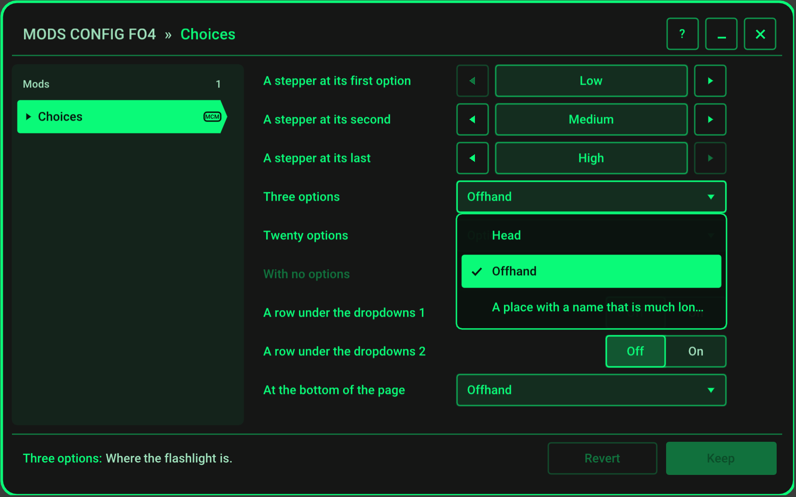

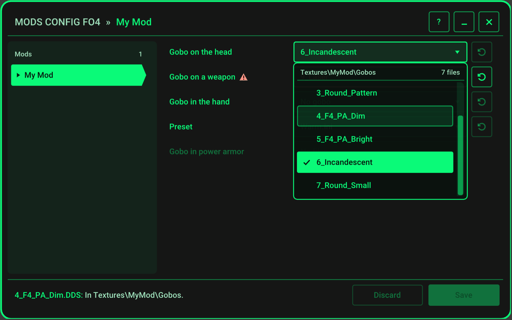

### Text inputs

A text, or a number typed on the keyboard, with limits that make a value invalid:

```json
{
  "type": "textinput",
  "valueType": "string",
  "text": "Code of 3 to 8 characters",
  "help": "Typing stops at 8 characters, and fewer than 3 is invalid.",
  "default": "ABC",
  "valueOptions": { "minLength": 3, "maxLength": 8 },
  "storage": { "path": ["TextInputs", "sCode"] }
}
```

A `valueType` of `int` or `float` takes a number, with `min` and `max` in its `valueOptions`.

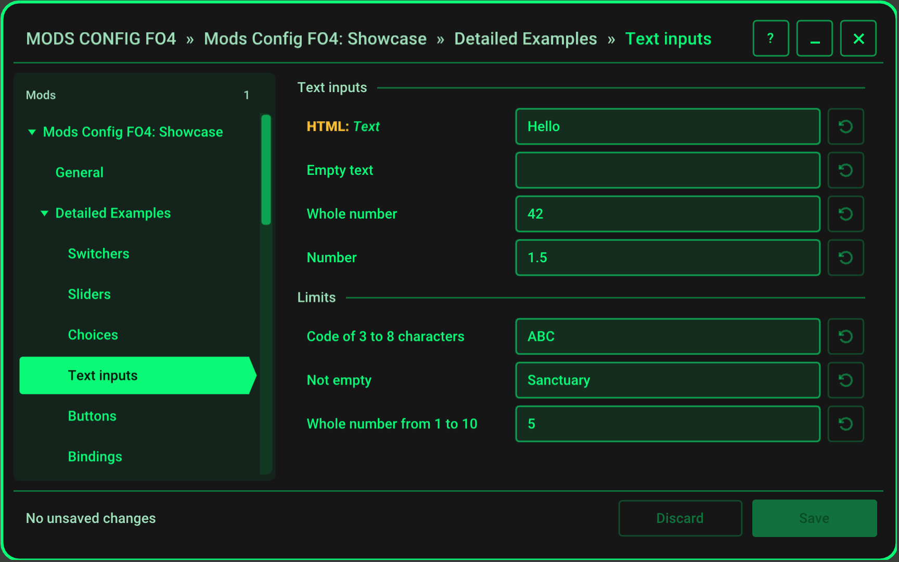

### Buttons

A button runs its `action`: a Papyrus function, a console command, a web page in the desktop browser, or a function of the mod's DLL.

```json
{
  "type": "button",
  "text": "An important button",
  "help": "Its style draws its outline, text and icon in the accent color, so a button that matters is not missed.",
  "buttonText": "Calibrate",
  "style": "important",
  "icon": "target",
  "action": {
    "type": "CallGlobalFunction",
    "script": "Debug",
    "function": "Notification",
    "params": ["Showcase: an important button"]
  }
}
```

- `action.type` is `CallFunction` or `CallGlobalFunction` as in MCM, `RunConsoleCommand` with a `command`, `OpenURL` with a `url`, or `CallNativeFunction`, a function the mod's DLL registered.
- `confirmation` asks first, with a `title` and a `message`. `"dangerous": true` asks in red.
- `style` is `important` or `dangerous`, and `icon` one of the menu's 18 icons, each on the page's **Every icon** section.
- A button that runs a script asks the player to save first, as the script reads the saved values.

See [Buttons](../design/schema.md#buttons).

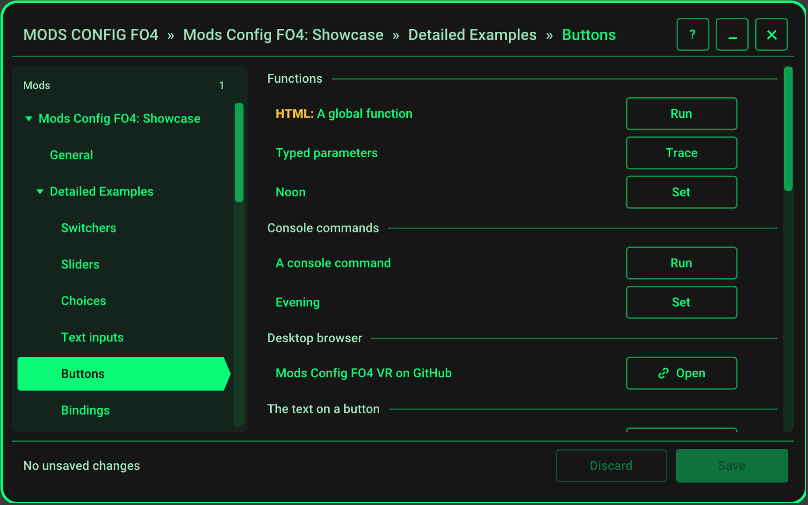

A button's `confirmation`, as the player sees it:

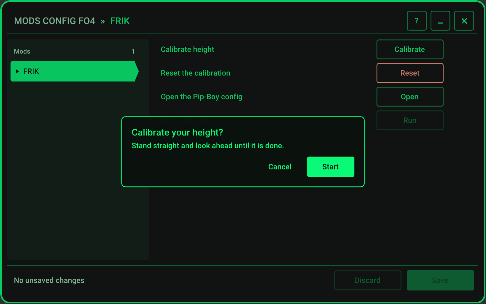

## CommonFramework Values

The values a mod built on the F4VR Common Framework keeps in its TOML, each in the framework's own form, so a config spec edits them with no code. See [CommonFramework values](../design/schema.md#commonframework-values).

### Bindings

A controller binding, `cf.inputBinding`: its icons and a sentence, and an editor of its hand, its type and its button. `valueOptions` can limit what it takes.

```json
{
  "type": "cf.inputBinding",
  "text": "Limited",
  "help": "It takes a press, a long press or a hold of the grip, A or B alone: its editor offers those.",
  "default": { "hand": "primary", "type": "press", "button": "grip" },
  "valueOptions": { "types": ["press", "longpress", "hold"], "buttons": ["grip", "a", "b"] },
  "storage": { "path": ["Bindings", "kLimited"] }
}
```

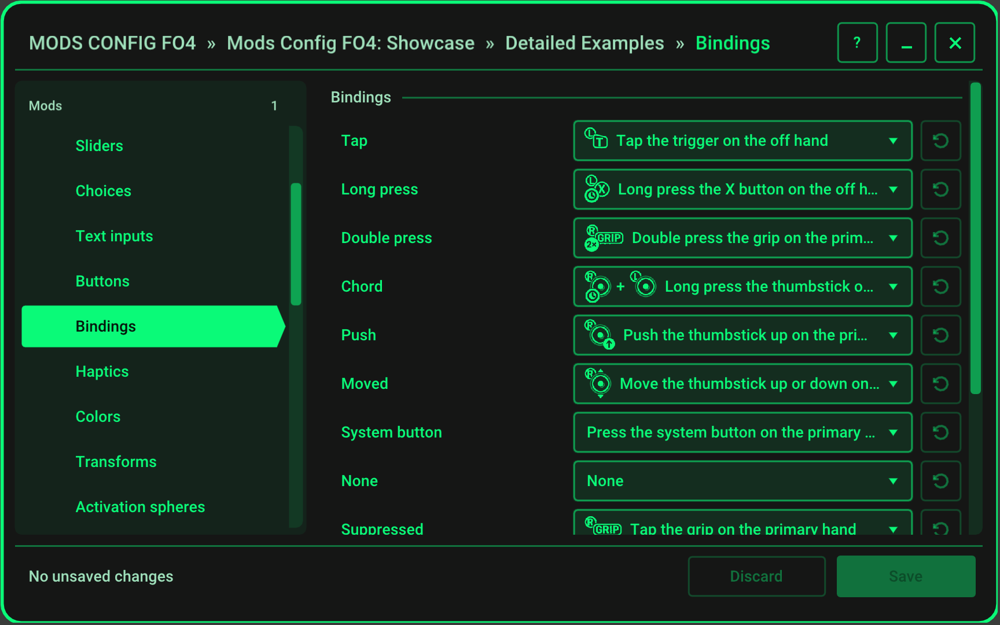

The editor of the Chord binding: its hand, its button, how it is pressed, its duration and the button held with it.

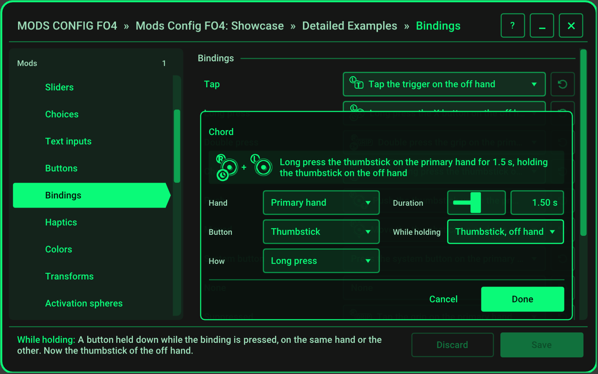

### Haptics

A haptic pattern, `cf.haptic`, by the framework's name: its shape, and Play, which plays it on the hand that points.

```json
{
  "type": "cf.haptic",
  "text": "Double click",
  "help": "Two quick taps. A file can write it as \"double click\" too, as the framework reads it.",
  "default": "DoubleClick",
  "storage": { "path": ["Haptics", "sDoubleClick"] }
}
```

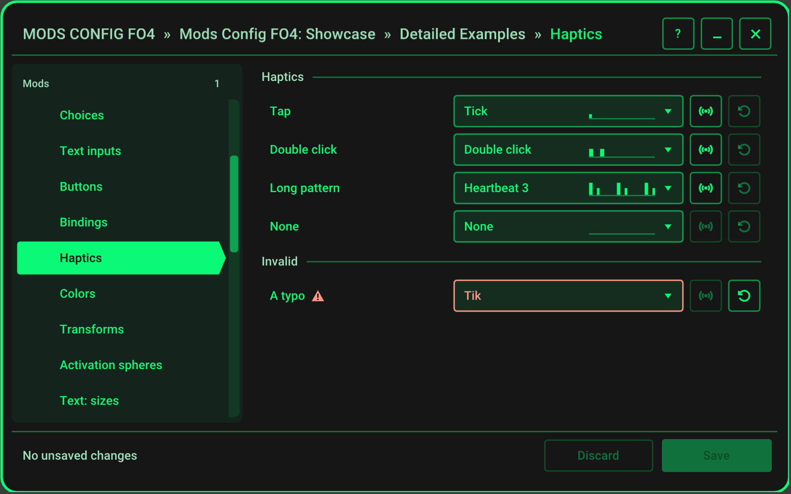

Its list shows each pattern's shape:

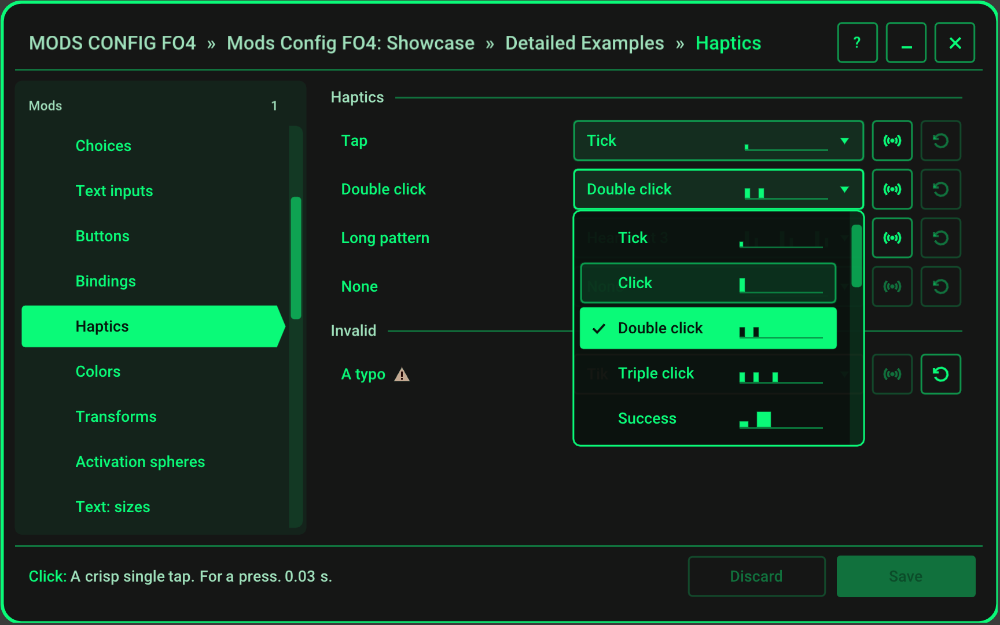

### Colors

A color, `cf.color`: a swatch and its numbers, and an editor with a picker. `"alpha": false` is a color of RGB only, and `sharedPresets` names a list of colors in the root's `sharedPresetLists`, which its editor offers.

```json
{
  "type": "cf.color",
  "text": "Light color",
  "help": "A light's color, whose opacity means nothing: it is RGB only. Its presets are the shared list of whites, which the beam's color has too.",
  "default": { "rgb": [255, 214, 170] },
  "valueOptions": { "alpha": false, "sharedPresets": "lights" },
  "storage": { "path": ["Colors", "cLight"] }
}
```

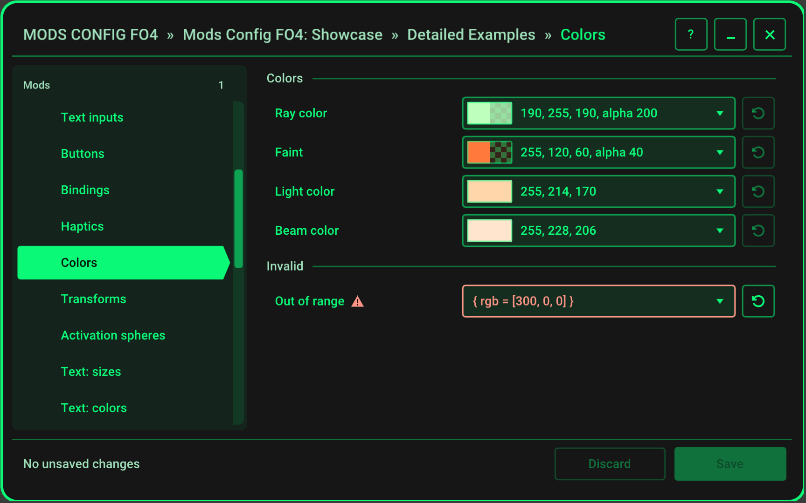

The editor: the color before and now, a picker, a slider for each channel, the presets of the config spec, and five basic colors every color has.

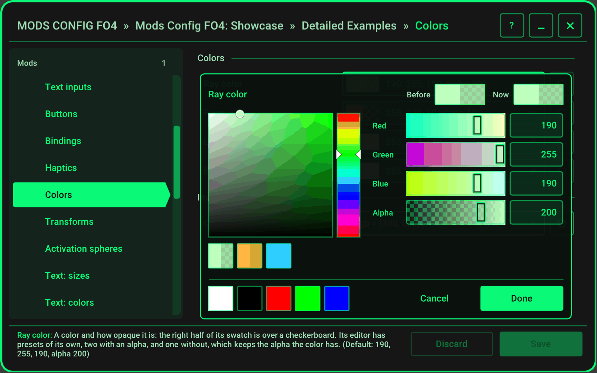

### Transforms

A position, a rotation and a scale, `cf.transform`: an editor of a slider for each axis. `valueOptions` sets the range of each part, and `false` leaves a part out.

```json
{
  "type": "cf.transform",
  "text": "Body grab zone",
  "help": "Rotation off, so the row is the one line, Z of 0 to 40, and a scale of 0.5 to 2.",
  "default": { "pos": [0.0, 0.0, 12.0], "scale": 1.2 },
  "valueOptions": {
    "position": { "min": -10, "max": 10, "step": 0.1, "z": { "min": 0, "max": 40 } },
    "rotation": false,
    "scale": { "min": 0.5, "max": 2.0 }
  },
  "storage": { "path": ["Transforms", "tZone"] }
}
```

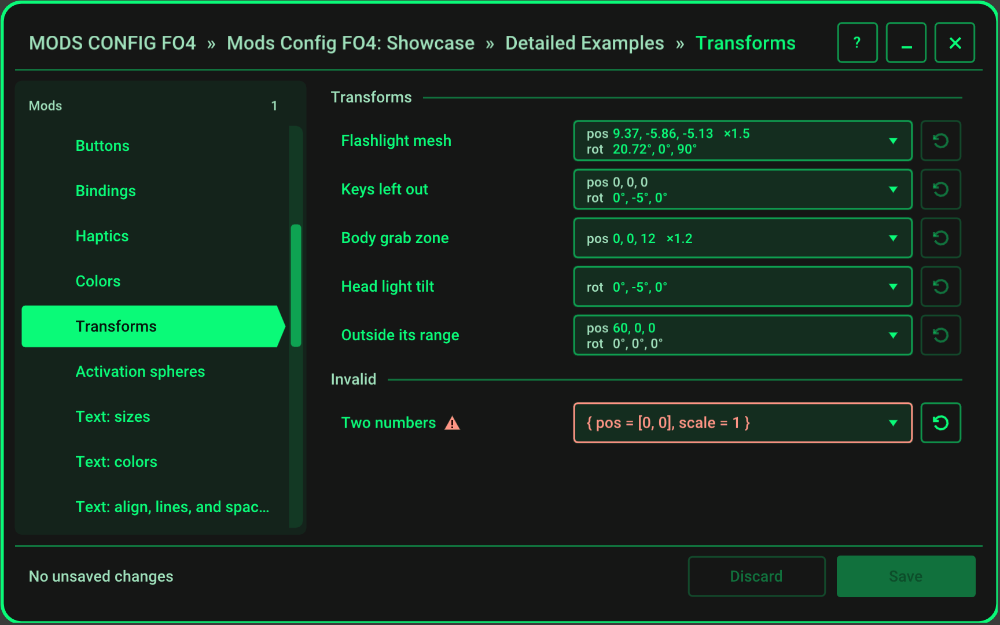

The editor has a slider for each axis of the parts the config spec turns on. A mod whose DLL is connected to the menu has **Adjust in world** too, which tunes it with the hand.

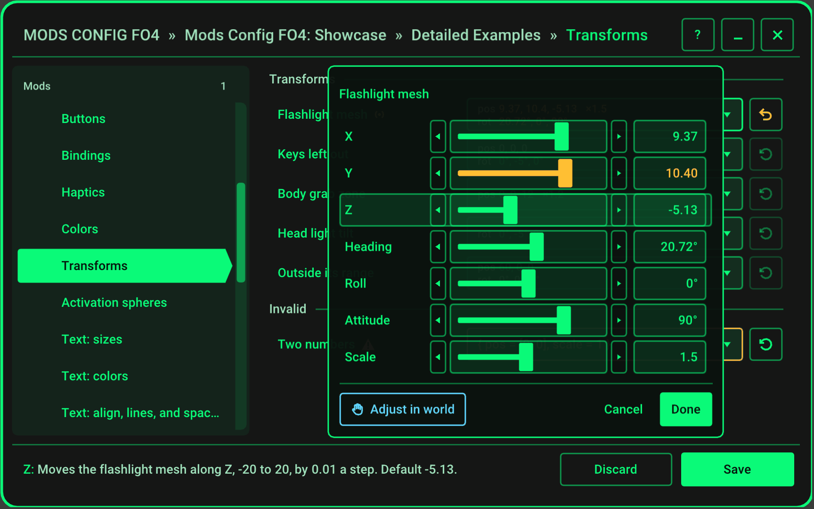

### Activation spheres

A section of the TOML that is an activation sphere, `cf.activationSphere`: one group of rows, one for each key. `keys` names a row, or hides it with `false`.

```json
{
  "type": "cf.activationSphere",
  "text": "With hidden keys",
  "help": "It hides its icon and its second binding, and its file has no power-armor zone, so those keys have no row.",
  "storage": { "path": ["HeadSphere"] },
  "keys": {
    "tZone": { "valueOptions": { "position": { "step": 0.1 }, "scale": { "min": 1, "max": 40, "step": 0.5 } } },
    "sShowIcon": false,
    "kSecondaryBinding": false,
    "sSecondaryHaptic": false
  }
}
```

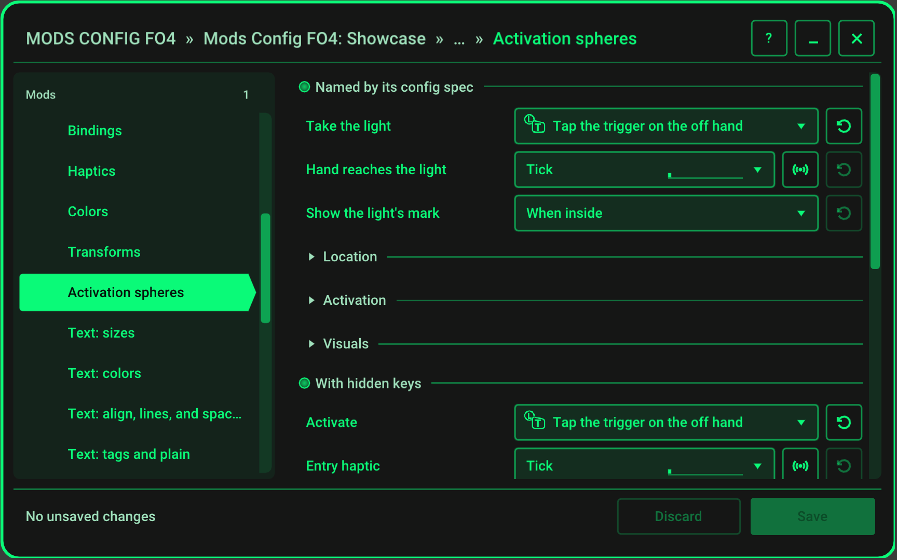

## The Look of a Page

### Text

A `text` row is a text of its own on the page. With `"html": true`, its text, or a setting's, takes the tags MCM's text does: a size, a color, bold, italic and underline, paragraphs at the left, center or right, and line breaks. A text can show a state of the mod's DLL, as `{clientState:status}`. The Showcase has four pages of them: sizes, colors, align and lines, and tags.

```json
{
  "type": "text",
  "text": "<p align='center'><font size='30'>A centered title</font></p><p>A paragraph under it, at the left.</p><p align='right'><font size='16'>And a note at the right</font></p>",
  "html": true
}
```

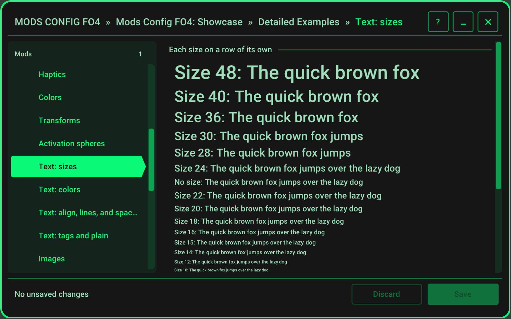

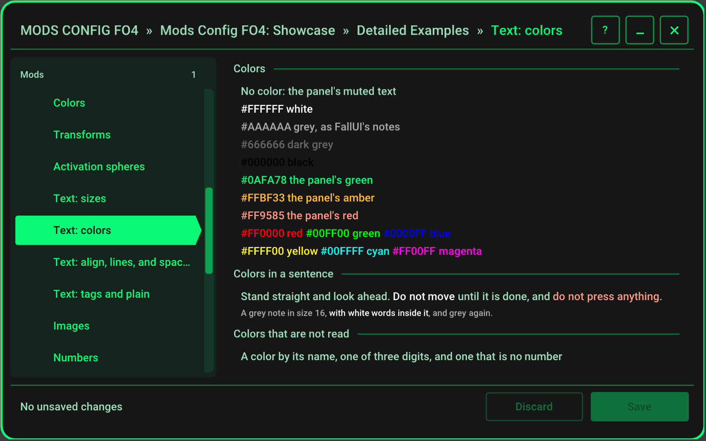

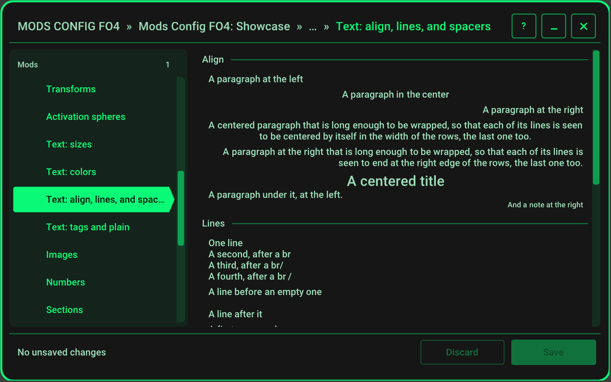

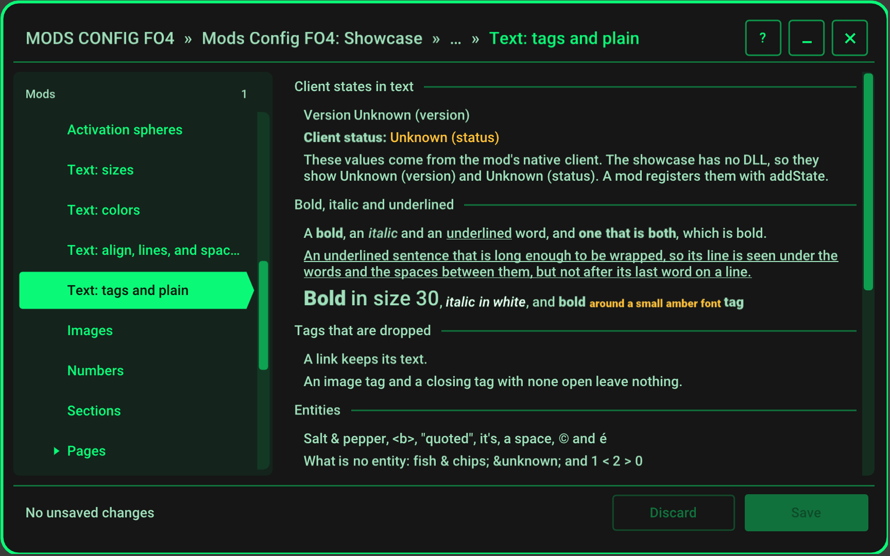

See [Text, spacers and images](../design/schema.md#text-spacers-and-images).

### Images

An `image` row draws a texture, by its path under `Data\Textures`, loose or in a BA2, at its own size, or the `width` and `height` it gives. A row can be shown by a setting, as any row can:

```json
{
  "type": "image",
  "texture": "ModsConfigFO4_Showcase/checker.dds",
  "width": 64,
  "height": 64,
  "visibleWhen": { "setting": "showPicture", "equals": true }
}
```

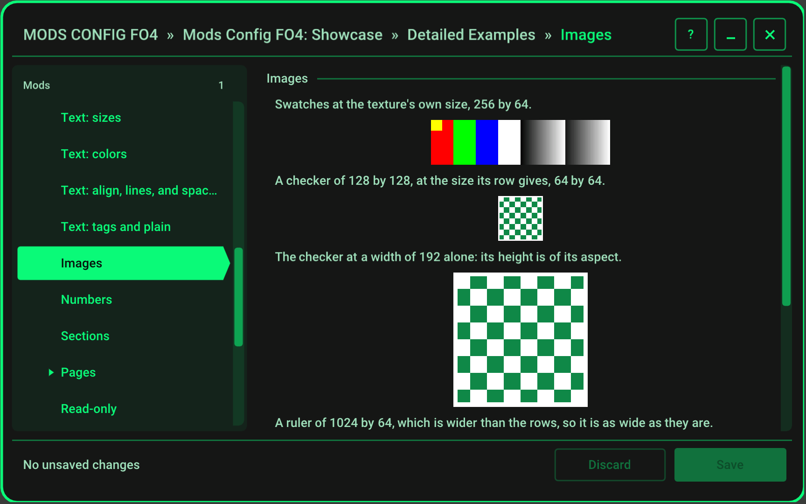

### Numbers

How a number is shown, by its `display`: its `decimals`, a `unit`, or `"percent": true`, a percentage of its range.

```json
{
  "type": "slider",
  "valueType": "int",
  "text": "Opacity",
  "help": "From 0 to 255, as a percentage: the help line has the number too.",
  "default": 217,
  "valueOptions": { "min": 0, "max": 255, "step": 1 },
  "display": { "percent": true },
  "storage": { "path": ["Numbers", "iOpacity"] }
}
```

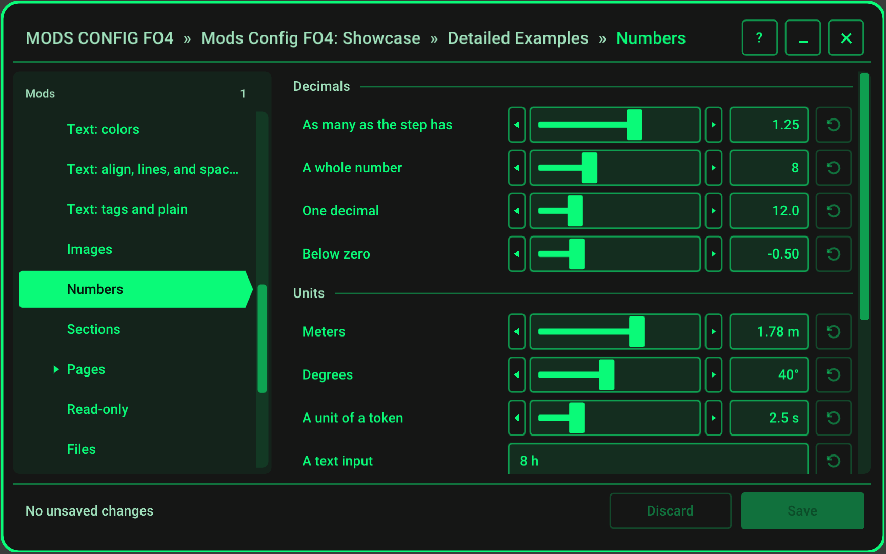

### Sections

A section has a heading and rows of its own, and sections inside it. `isCollapsible` makes it fold, and `collapsed` folds it each time the page is shown.

```json
{
  "type": "section",
  "text": "Advanced",
  "help": "A section that folds, folded each time the page is shown. Change a row in it and fold it.",
  "isCollapsible": true,
  "collapsed": true,
  "content": []
}
```

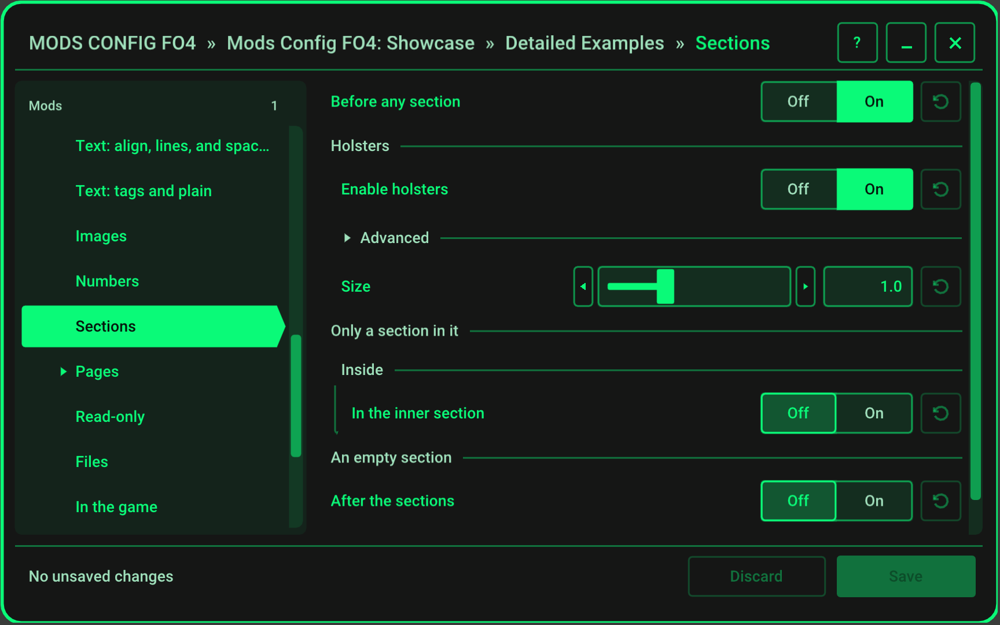

### Pages

A page can have pages of its own, as deep as you need. A page can be hidden or disabled by a setting, with the pages under it:

```json
{
  "pageDisplayName": "Conditional page",
  "help": "Its visibility and enabled state follow the two switches on Pages.",
  "visibleWhen": { "setting": "showConditionalPage", "equals": true },
  "enabledWhen": { "setting": "enableConditionalPage", "equals": true },
  "content": []
}
```

See [Pages](../design/schema.md#pages).

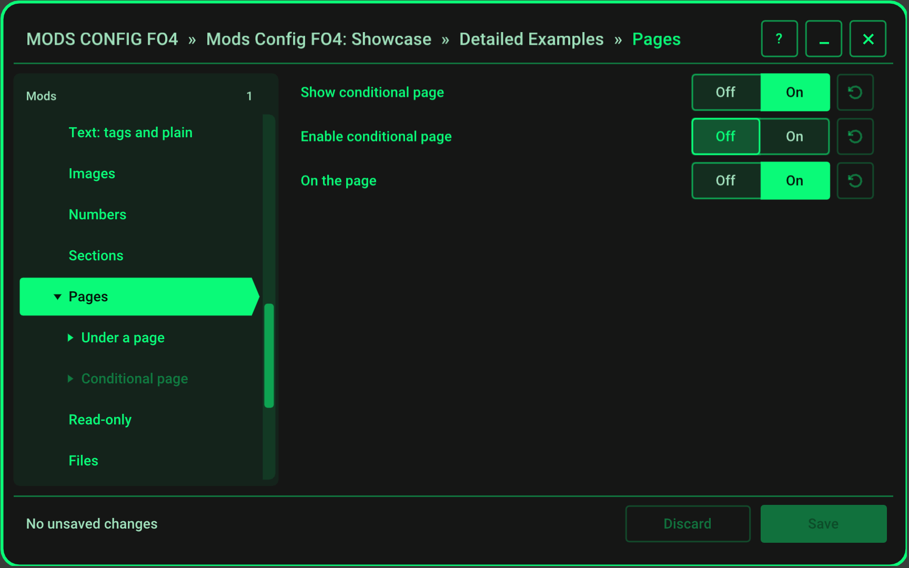

## How Settings Behave

### Read-only

A value the mod writes for the player to read, as a measured height: `"readOnly": true`. It has no `default` and no Reset.

```json
{
  "type": "slider",
  "valueType": "float",
  "text": "Measured height",
  "help": "A slider that is only shown, with no Reset.",
  "readOnly": true,
  "valueOptions": { "min": 1, "max": 2.5, "step": 0.01 },
  "display": { "unit": "m" },
  "storage": { "path": ["ReadOnly", "fHeight"] }
}
```

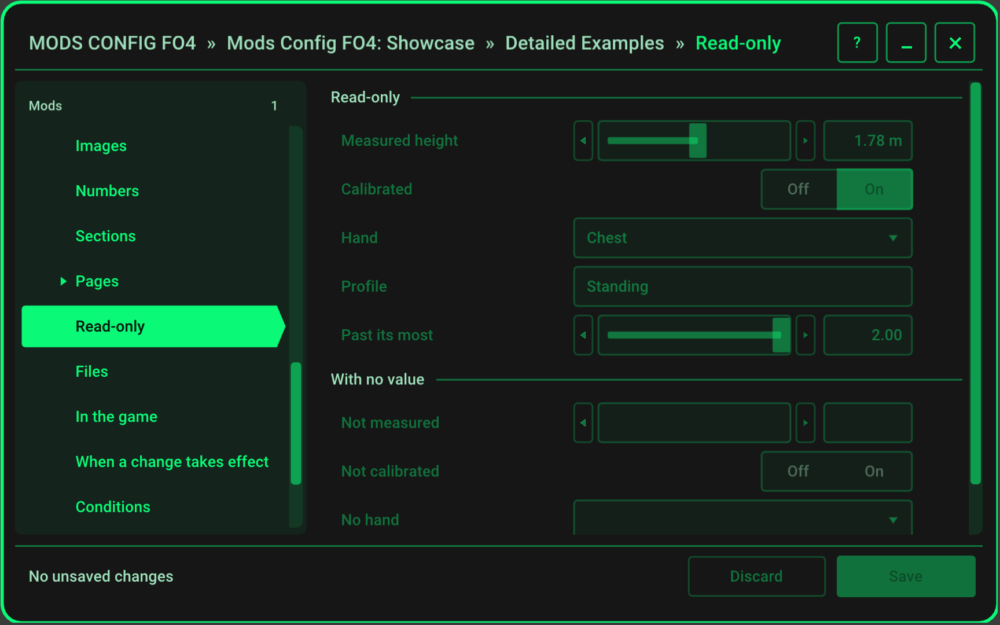

### Files

A config spec can edit several files, named in its root's `files`. A setting's file is its `storage.file`, or the `defaultFile` of its section, of its page, or of the config spec, the nearest first. A key of a TOML file is its `path`, which can go into tables of tables, and a key of an INI file its `section` and `key`:

```json
{
  "type": "section",
  "text": "A section's file: an INI file",
  "defaultFile": "ini",
  "content": [
    {
      "type": "switcher",
      "valueType": "bool",
      "text": "INI switcher",
      "help": "A key of an INI file, by its section and its key. It is written as 1 or 0, as the file has it.",
      "default": true,
      "storage": { "section": "Ini", "key": "bSwitcher" }
    }
  ]
}
```

A file that is not there yet is created by the first Save that changes one of its settings. A Save writes a file in place, keeping its comments, its blank lines and the order of its keys. See [Files](../design/schema.md#files) and [Storage](../design/schema.md#storage).

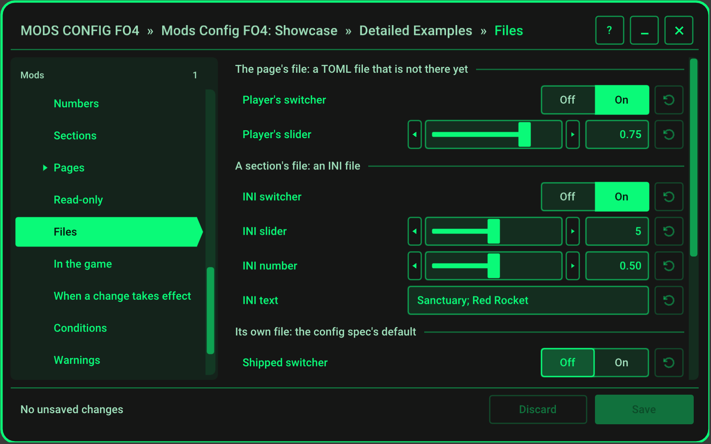

### In the game

A script mod keeps its settings in globals and properties of its scripts: they are in the save game, not in a file. A setting can also have an `action`, which Save runs with its value.

```json
{
  "type": "slider",
  "id": "timeOfDay",
  "valueType": "float",
  "text": "Time of day",
  "help": "The game's global GameHour, live: the time changes as the slider moves.",
  "default": 12.0,
  "valueOptions": { "min": 0, "max": 24, "step": 0.25 },
  "display": { "decimals": 2, "unit": "h" },
  "applies": "live",
  "storage": { "global": "Fallout4.esm|38" }
}
```

A property is `{ "form": "MyMod.esp|800", "scriptName": "MyMod:ConfigScript", "propertyName": "fStrength" }`. See [Global and script property](../design/schema.md#global-and-script-property) and [A setting's action](../design/schema.md#a-settings-action).

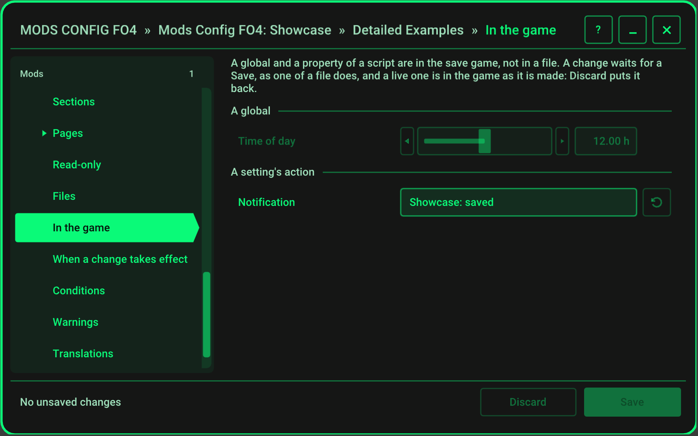

### When a change takes effect

`applies` tells the player when a change reaches your mod: `live`, as it is made, `save`, after Save, `restart`, after the game is restarted, or `unknown`. It is set for the config spec, and a page, a section or a setting can have its own. A `live` setting is previewed before Save by the mod's DLL, or by the menu itself for a global or a property.

```json
{
  "type": "section",
  "text": "A section's: after a restart",
  "applies": "restart",
  "content": []
}
```

See [When a change takes effect](../design/schema.md#when-a-change-takes-effect).

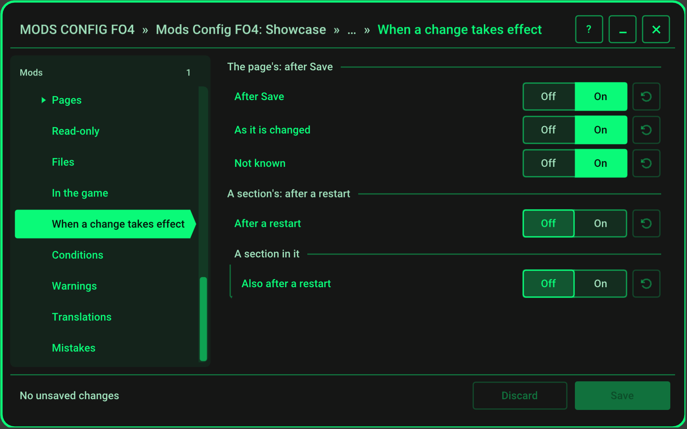

### Conditions

`visibleWhen` shows a row, a section or a page while its condition holds, and `enabledWhen` lets it be edited. A condition asks a setting, named by its `id`, a game plugin or an F4SE plugin, or a state of the mod's DLL, and combines them with `any`, `all` and `not`:

```json
{
  "type": "switcher",
  "valueType": "bool",
  "text": "Any of two",
  "help": "Shown while Show rows is off or Level is 10.",
  "default": false,
  "storage": { "path": ["Conditions", "bAny"] },
  "visibleWhen": {
    "any": [
      { "setting": "showRows", "equals": false },
      { "setting": "level", "equals": 10 }
    ]
  }
}
```

A setting is compared with `equals`, `oneOf`, `lessThan`, `greaterThan` and the others the page has, one row each. See [Conditions](../design/schema.md#conditions).

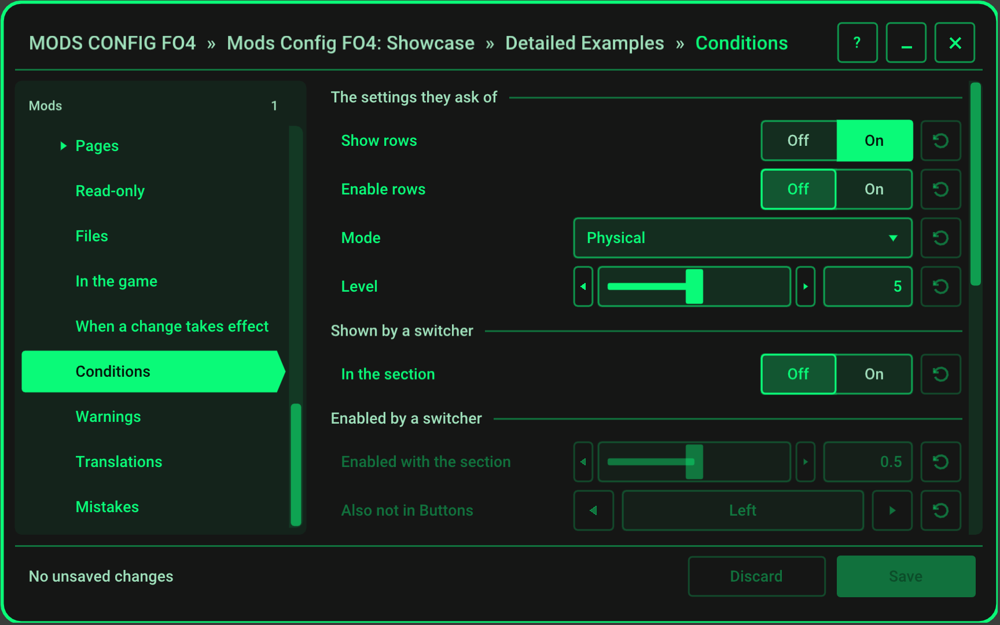

### Warnings

A warning marks a value that works but has a cost, or a button whose action needs something of the player. It blocks nothing.

```json
{
  "id": "playerHeight",
  "type": "slider",
  "valueType": "float",
  "text": "Player height",
  "help": "It warns above 1.4 m, as it is shipped. Move it to 1.4 m or less and its warning goes.",
  "default": 1.45,
  "valueOptions": { "min": 0.5, "max": 2, "step": 0.01 },
  "display": { "unit": "m" },
  "storage": { "path": ["Warnings", "fPlayerHeight"] },
  "warnings": [
    { "when": { "setting": "playerHeight", "greaterThan": 1.4 }, "text": "Above 1.4 m your view can be in the ceiling." }
  ]
}
```

See [Warnings](../design/schema.md#warnings).

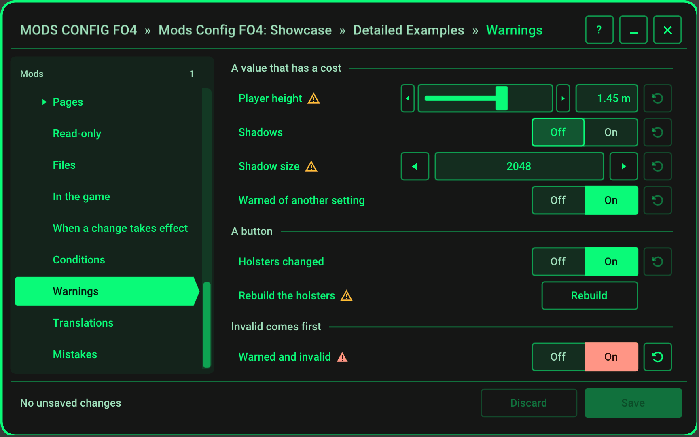

### Translations

A text is plain, a `$` token of the game's translation files as in MCM, or a token with a `fallback`, which is shown when no file has the token:

```json
{
  "type": "switcher",
  "valueType": "bool",
  "text": { "token": "$ModsConfigFO4_Showcase_Fallback", "fallback": "A token with a fallback" },
  "help": { "token": "$ModsConfigFO4_Showcase_FallbackHelp", "fallback": "No translation file has its token, so it is its fallback." },
  "default": true,
  "storage": { "path": ["Texts", "bFallback"] }
}
```

The translation files are your mod's `Data\Interface\Translations\<plugin>_<language>.txt`, the ones an MCM menu already has. So a config spec whose fallbacks are English needs no English file. See [Localization](../design/schema.md#localization).

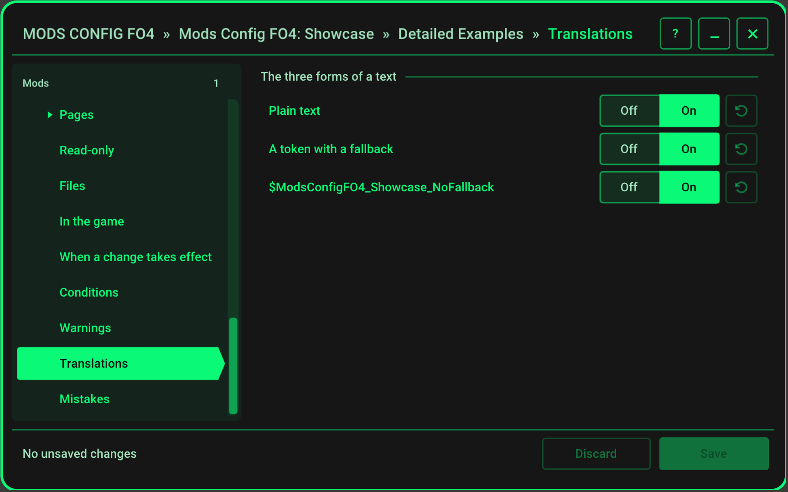

## Mistakes

What a config spec can get wrong, a row for each: storage that is not there, settings and choices that don't hold together, conditions, buttons, sections, rows and fields the menu doesn't read, and images it can't load. Each row says what is wrong, and the menu reports the error, in **Developer tools** and in the log. See [Testing It in the Game](README.md#testing-it-in-the-game) and [Validation](../design/schema.md#validation).

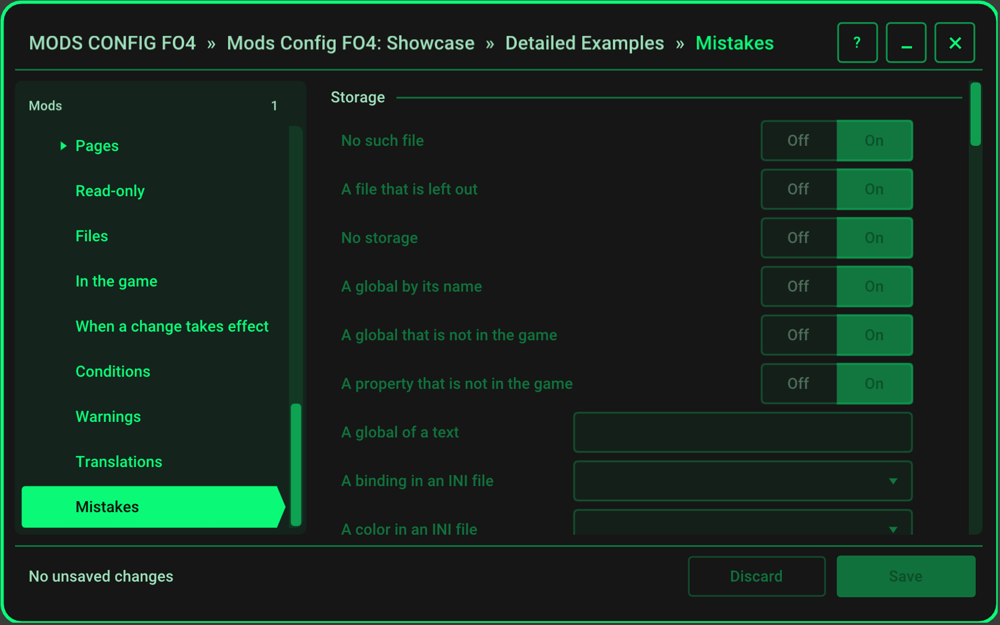
